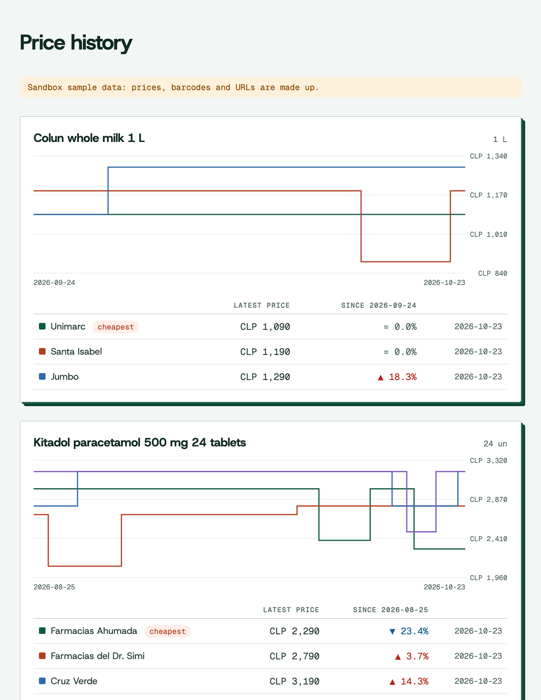
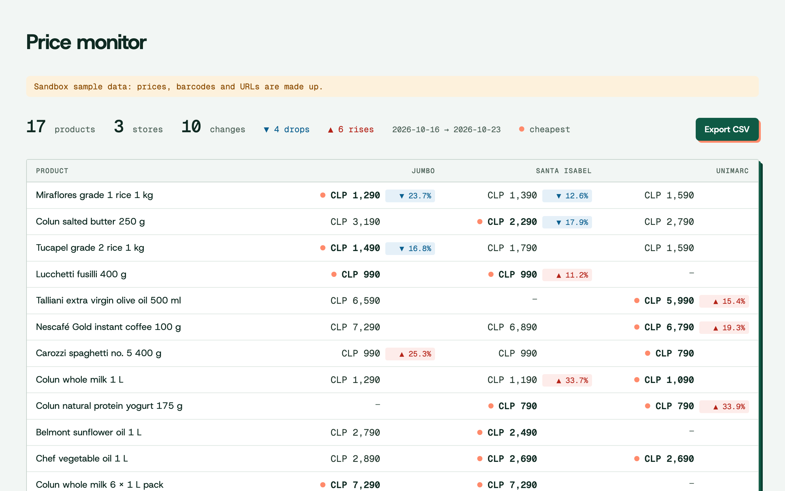

# price-tracker

English · [Español](README.md)

Track a list of products sold by Chilean retailers, keep their price history per store in a SQLite file and chart it. With many SKUs (a whole brand or category) it builds a monitor of price changes and exports it to CSV. Python 3.10+, no dependencies.



## Try it in a minute

No account needed: without `PRICES_API_KEY` the tracker uses the public sandbox (`sk_test_sandbox`), which answers with sample data.

```bash
uvx --from git+https://github.com/MarceloFarrMintii/price-tracker price-tracker --lang en add "whole milk"
```

```text
Tracking: Colun whole milk 1 L (prd_01colu) · 3 stores · 30 days of history
  Unimarc                   CLP 1,090   2026-10-23
  Santa Isabel              CLP 1,190   2026-10-23
  Jumbo                     CLP 1,290   2026-10-23
Other matches (add by id):
  prd_04colu  Colun whole milk 6 x 1 L pack
  prd_02sopr  Soprole skimmed milk 1 L
  prd_03lonc  Loncoleche lactose-free semi-skimmed milk 1 L
```

With `pip`: `pip install git+https://github.com/MarceloFarrMintii/price-tracker`, then `price-tracker ...`.

## Commands

| Command | What it does |
|---|---|
| `price-tracker add "paracetamol"` | Searches and tracks the first match. Takes text, a `product_id` (`prd_...`) or a barcode. `--days 60` loads more history (default 30). |
| `price-tracker add --brand colun` | Tracks every product of a brand. `--category food.dairy` does the same for a category. |
| `price-tracker update` | Saves today's price of every product, 500 per call, and shows the change against the previous day. |
| `price-tracker list` | Tracked products with their latest price per store, cheapest first. |
| `price-tracker chart` | Writes `prices.html`: one step chart per product, no JavaScript. `-o` sets the file. |
| `price-tracker report --csv monitor.csv` | Writes `monitor.html`: a table of every product and store with each price change and the cheapest store, plus the CSV. `--vs 7` compares against 7 days earlier (default 1). |
| `price-tracker remove prd_01colu` | Stops tracking a product. |

Global options: `--db` (SQLite file, `prices.db` by default, or `PRICE_TRACKER_DB`) and `--lang es|en` (language of messages and product names; defaults to `LANG`).

## Monitor many SKUs

For a brand watching its own products and its competitors' at every store:

```bash
price-tracker add --category food.dairy --days 14
price-tracker add --category food.pantry --days 14
price-tracker update                         # one call for all of them
price-tracker report --vs 7 --csv monitor.csv
```



Products that changed come first, biggest drop on top. The CSV has one row per product and store: `product_id, name, retailer, day, price, previous_day, previous_price, change_pct`. To get a notification instead of opening the table, see [price-alerts-bot](https://github.com/MarceloFarrMintii/price-alerts-bot) (ntfy or webhook).

## Every day

To build your own history, schedule `update` once a day (prices are captured daily):

```bash
# crontab -e
30 9 * * * cd ~/prices && price-tracker update >> update.log 2>&1
```

## With your key

```bash
export PRICES_API_KEY=sk_live_...
price-tracker add 7802920000017
```

| Variable | What for | Default |
|---|---|---|
| `PRICES_API_KEY` | Your API key | `sk_test_sandbox` (sample data) |
| `PRICES_API_URL` | Another API instance | `https://mercali-platform.vercel.app` |

What it costs (measured against the demo API, 2026-10-24): adding a product sold at 4 stores with 30 days of history is 9 credits (1 for the search, 4 for prices and 4 for history); each `update` charges 1 credit per store, and repeating the same query within 24 hours is free. Every response reports the charge in `meta.credits_charged`.

## How it works

About 500 lines, a third of them HTML and CSS, in [`src/price_tracker/`](src/price_tracker):

- `api.py`: REST client on `urllib`. Retries `429` honoring `Retry-After` and turns errors (RFC 9457) into an `ApiError` with its `code` and a hint on what to do.
- `tracker.py`: `GET /v1/products/search` to find the product (or `GET /v1/products?brand=` / `?category=` for many), `GET /v1/products/{id}/prices` for today's price at every store and `GET /v1/products/{id}/history?interval=day` for the previous days. From the history it keeps only the offers that `/prices` identifies as the same item (history also returns multipacks). `update` uses `POST /v1/prices/batch`, up to 500 products per call.
- `store.py`: SQLite with one price per offer and day; running `update` twice on the same day duplicates nothing.
- `chart.py` and `report.py`: the HTML pages (SVG chart and monitor), with the fonts embedded so they open offline, and the CSV.

`price` is what anyone pays. Store-card prices (`card_price`) and multi-buy promotions come separately in the API and this example doesn't mix them in.

## Tests

They run against the public sandbox:

```bash
git clone https://github.com/MarceloFarrMintii/price-tracker && cd price-tracker
uv run pytest
```

`PRICES_API_URL=http://localhost:8787 uv run pytest` runs them against a local instance.

## License

Code under [MIT](LICENSE). The Host Grotesk and Geist Mono fonts are included under the [SIL Open Font License 1.1](src/price_tracker/assets/OFL.txt).
