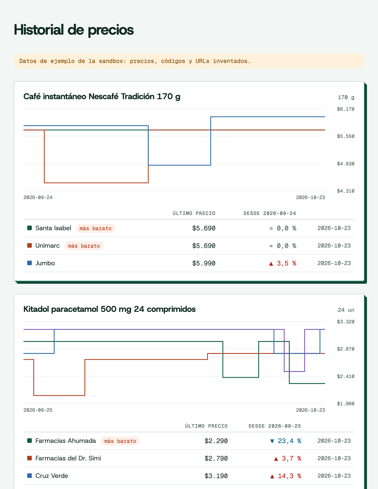

# price-tracker

[English](README.en.md) · Español

Sigue una lista de productos del retail chileno, guarda su historial de precios por tienda en un archivo SQLite y lo muestra en un gráfico. Python 3.10+, sin dependencias.



## Pruébalo en un minuto

No necesitas cuenta: sin `PRICES_API_KEY`, el tracker usa la sandbox pública (`sk_test_sandbox`), que responde con datos de ejemplo.

```bash
uvx --from git+https://github.com/MarceloFarrMintii/price-tracker price-tracker add "leche entera"
```

```text
Siguiendo: Leche entera Colun 1 L (prd_01colu) · 3 tiendas · 30 días de historial
  Unimarc                      $1.090   2026-10-23
  Santa Isabel                 $1.190   2026-10-23
  Jumbo                        $1.290   2026-10-23
Otros resultados (agrega por id):
  prd_04colu  Leche entera Colun pack 6 x 1 L
  prd_02sopr  Leche descremada Soprole 1 L
  prd_03lonc  Leche semidescremada sin lactosa Loncoleche 1 L
```

Con `pip`: `pip install git+https://github.com/MarceloFarrMintii/price-tracker` y después `price-tracker ...`.

## Comandos

| Comando | Qué hace |
|---|---|
| `price-tracker add "paracetamol"` | Busca y sigue el primer resultado. Acepta texto, un `product_id` (`prd_...`) o un código de barras. `--days 60` carga más historial (30 por omisión). |
| `price-tracker update` | Guarda el precio de hoy de cada producto y muestra la variación contra el día anterior. |
| `price-tracker list` | Productos seguidos con su último precio por tienda, del más barato al más caro. |
| `price-tracker chart` | Escribe `prices.html`: un gráfico escalonado por producto, sin JavaScript. `-o` cambia el archivo. |
| `price-tracker remove prd_01colu` | Deja de seguir un producto. |

Opciones globales: `--db` (archivo SQLite, `prices.db` por omisión, o `PRICE_TRACKER_DB`) y `--lang es|en` (idioma de los mensajes y de los nombres de producto; por omisión, el de `LANG`).

Para juntar historial propio, programa `update` una vez al día (los precios se capturan a diario):

```bash
# crontab -e
30 9 * * * cd ~/precios && price-tracker update >> update.log 2>&1
```

## Con tu key

```bash
export PRICES_API_KEY=sk_live_...
price-tracker add 7802920000017
```

| Variable | Para qué | Por omisión |
|---|---|---|
| `PRICES_API_KEY` | Tu API key | `sk_test_sandbox` (datos de ejemplo) |
| `PRICES_API_URL` | Otra instancia de la API | `https://mercali-platform.vercel.app` |

Cuánto cuesta (medido contra la API de demo, 24-10-2026): agregar un producto vendido en 4 tiendas con 30 días de historial son 9 créditos (1 de búsqueda, 4 de precios y 4 de historial); cada `update` cobra 1 crédito por tienda y repetir la misma consulta dentro de 24 horas es gratis. Cada respuesta informa lo cobrado en `meta.credits_charged`.

## Cómo funciona

Unas 350 líneas, un tercio de ellas el gráfico y su CSS, en [`src/price_tracker/`](src/price_tracker):

- `api.py`: cliente de la API REST con `urllib`. Reintenta los `429` respetando `Retry-After` y convierte los errores (RFC 9457) en `ApiError` con su `code` y una pista de qué hacer.
- `tracker.py`: `GET /v1/products/search` para encontrar el producto, `GET /v1/products/{id}/prices` para el precio de hoy en cada tienda y `GET /v1/products/{id}/history?interval=day` para los días anteriores. Del historial guarda solo las ofertas que `/prices` reconoce como el mismo artículo (el historial también trae packs).
- `store.py`: SQLite con un precio por oferta y día; volver a correr `update` el mismo día no duplica nada.
- `chart.py`: la página HTML con SVG, con las fuentes incluidas, para abrirla sin internet.

El campo `price` es lo que paga cualquier persona. Los precios con tarjeta de la tienda (`card_price`) y las promociones por cantidad vienen aparte en la API y este ejemplo no los mezcla.

## Tests

Corren contra la sandbox pública:

```bash
git clone https://github.com/MarceloFarrMintii/price-tracker && cd price-tracker
uv run pytest
```

`PRICES_API_URL=http://localhost:8787 uv run pytest` los corre contra una instancia local.

## Licencia

Código bajo [MIT](LICENSE). Las fuentes Host Grotesk y Geist Mono van incluidas bajo la [SIL Open Font License 1.1](src/price_tracker/assets/OFL.txt).
