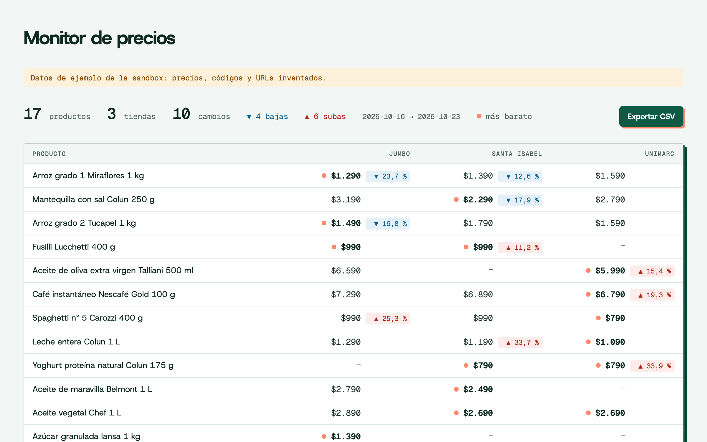

# API de precios de supermercados de Chile: seguimiento e historial

[](https://github.com/Pricto/precios-supermercados-chile/actions/workflows/tests.yml)
[](LICENSE)
[](pyproject.toml)
[](https://pricto.dev)

Sigue el precio de productos de supermercados y farmacias de Chile (Jumbo, Unimarc, Santa Isabel, Cruz Verde, Farmacias Ahumada y más) con la API de precios de [Pricto](https://pricto.dev): guarda el historial por tienda en SQLite, lo grafica y arma un monitor de competencia con los cambios de precio y exportación a CSV. Python 3.10+, sin dependencias.

[In English](#in-english) · [Docs de la API](https://pricto.dev/docs) · [Cobertura](https://pricto.dev/cobertura) · [Crear cuenta gratis](https://pricto.dev/registro)


## Pruébalo en un minuto

No necesitas cuenta: sin `PRICTO_API_KEY`, el tracker usa la sandbox pública de Pricto (`sk_test_sandbox`), que responde con datos de ejemplo. Con [uv](https://docs.astral.sh/uv/):

```bash
uvx --from git+https://github.com/Pricto/precios-supermercados-chile price-tracker add "leche entera"
```

```text
Siguiendo: Leche entera Colun 1 L (prd_01colu) · 3 tiendas · 30 días de historial
  Unimarc                      $1.090   2026-10-23
  Santa Isabel                 $1.190   2026-10-23
  Jumbo                        $1.290   2026-10-23
Otros resultados (agrega por id):
  prd_04colu  Leche entera Colun pack 6 x 1 L
  prd_02sopr  Leche descremada Soprole 1 L
  prd_03lonc  Leche semidescremada sin lactosa Loncoleche 1 L
```

Con `pip`: `pip install git+https://github.com/Pricto/precios-supermercados-chile` y después `price-tracker ...`.

## Qué tiendas cubre

Los datos son los de la API de Pricto, que captura a diario los precios online públicos de más de 120 tiendas de Chile ([lista completa y estado de cada una](https://pricto.dev/cobertura), registro de fuentes al 24-10-2026):

- Supermercados: Jumbo, Santa Isabel, Unimarc, Alvi, Mayorista Nacional, Supermercado La Herradura, Supermercados José González, Alimentika, Compras Aqui y Distribuidora Fermarket.
- Farmacias: Cruz Verde, Farmacias Ahumada, Farmacias del Dr. Simi, Farmacias Knop, Farmacias Novasalud, EcoFarmacias, Farmacia Meki, Farmaloop, Farmazon y Cofar.
- También tecnología, hogar, tiendas por departamento, mascotas, deportes, licores, libros y juguetes.

No cubre Líder, Tottus, Superbodega aCuenta, Central Mayorista, Salcobrand ni Preunic: bloquean a los robots que se identifican o sus términos no lo permiten. La sandbox trae datos inventados de 7 de esas cadenas (Jumbo, Santa Isabel, Unimarc, Cruz Verde, Farmacias Ahumada, Dr. Simi y Knop); los precios reales se ven con una [cuenta gratis](https://pricto.dev/registro).

## Comandos

| Comando | Qué hace |
|---|---|
| `price-tracker add "paracetamol"` | Busca y sigue el primer resultado. Acepta texto, un `product_id` (`prd_...`) o un código de barras. `--days 60` carga más historial (30 por omisión). |
| `price-tracker add --brand colun` | Sigue todos los productos de una marca. `--category food.dairy` hace lo mismo con una categoría. |
| `price-tracker update` | Guarda el precio de hoy de todos los productos, de a 500 por llamada, y muestra la variación contra el día anterior. |
| `price-tracker list` | Productos seguidos con su último precio por tienda, del más barato al más caro. |
| `price-tracker chart` | Escribe `prices.html`: un gráfico escalonado por producto, sin JavaScript. `-o` cambia el archivo. |
| `price-tracker report --csv monitor.csv` | Escribe `monitor.html`: una tabla con todos los productos y tiendas, el cambio de cada precio y la tienda más barata, más el CSV. `--vs 7` compara contra 7 días antes (1 por omisión). |
| `price-tracker remove prd_01colu` | Deja de seguir un producto. |

Opciones globales: `--db` (archivo SQLite, `prices.db` por omisión, o `PRICE_TRACKER_DB`) y `--lang es|en` (idioma de los mensajes y de los nombres de producto; por omisión, el de `LANG`).

## Monitorear a la competencia (muchos SKU)

Para una marca que sigue sus productos y los de la competencia en cada supermercado:

```bash
price-tracker add --category food.dairy --days 14
price-tracker add --category food.pantry --days 14
price-tracker update                         # una sola llamada para todos
price-tracker report --vs 7 --csv monitor.csv
```



Primero van los productos que cambiaron, la baja más grande arriba. El CSV trae una fila por producto y tienda: `product_id, name, retailer, day, price, previous_day, previous_price, change_pct`. Para recibir un aviso en vez de abrir la tabla, mira [alertas-de-precios-chile](https://github.com/Pricto/alertas-de-precios-chile) (ntfy o webhook).

## Todos los días

Para juntar historial propio, programa `update` una vez al día (los precios se capturan a diario):

```bash
# crontab -e
30 9 * * * cd ~/precios && price-tracker update >> update.log 2>&1
```

## Pregúntale a tu agente

Los mismos datos están en el servidor MCP de Pricto, así que un agente (Claude, Cursor, VS Code, ChatGPT) puede responder estas preguntas sin código. Conéctalo a la sandbox, sin login:

```bash
claude mcp add --transport http pricto https://pricto.dev/mcp/sandbox
```

Otros clientes y la conexión con tu key, en [pricto.dev/docs/mcp](https://pricto.dev/docs/mcp). Preguntas que responde con los datos de la sandbox:

- ¿Cuánto cuesta hoy la leche entera Colun de 1 litro en Jumbo, Unimarc y Santa Isabel?
- ¿Cómo cambió el precio del arroz Tucapel grado 2 en cada supermercado en el último mes?
- ¿Qué productos de leche están en promoción en Jumbo?
- ¿En qué farmacia sale más barato el Kitadol de 24 comprimidos?

Si abres este repo con el agente, también puede usar el tracker por ti: "agrega todos los productos Colun y muéstrame cuáles cambiaron de precio esta semana" son `price-tracker add --brand colun`, `update` y `report --vs 7`.

## Con tu key

```bash
export PRICTO_API_KEY=sk_live_...
price-tracker add 7802920000017
```

| Variable | Para qué | Por omisión |
|---|---|---|
| `PRICTO_API_KEY` | Tu API key ([crear cuenta gratis](https://pricto.dev/registro), la copias en la consola) | `sk_test_sandbox` (datos de ejemplo) |
| `PRICTO_API_URL` | Otra instancia de la API | `https://pricto.dev` |

Cuánto cuesta (medido contra la API de demo, 24-10-2026): agregar un producto vendido en 4 tiendas con 30 días de historial son 9 créditos (1 de búsqueda, 4 de precios y 4 de historial); cada `update` cobra 1 crédito por tienda y repetir la misma consulta dentro de 24 horas es gratis. Cada respuesta informa lo cobrado en `meta.credits_charged`. Planes en [pricto.dev/precios](https://pricto.dev/precios).

## Cómo funciona

Unas 500 líneas, un tercio de ellas HTML y CSS, en [`src/price_tracker/`](src/price_tracker):

- `api.py`: cliente de la API REST con `urllib`. Reintenta los `429` respetando `Retry-After` y convierte los errores (RFC 9457) en `ApiError` con su `code` y una pista de qué hacer.
- `tracker.py`: `GET /v1/products/search` para encontrar el producto (o `GET /v1/products?brand=` / `?category=` para muchos), `GET /v1/products/{id}/prices` para el precio de hoy en cada tienda y `GET /v1/products/{id}/history?interval=day` para los días anteriores. Del historial guarda solo las ofertas que `/prices` reconoce como el mismo artículo (el historial también trae packs). `update` usa `POST /v1/prices/batch`, hasta 500 productos por llamada.
- `store.py`: SQLite con un precio por oferta y día; volver a correr `update` el mismo día no duplica nada.
- `chart.py` y `report.py`: las páginas HTML (gráfico en SVG y monitor), con las fuentes incluidas para abrirlas sin internet, y el CSV.

El campo `price` es lo que paga cualquier persona. Los precios con tarjeta de la tienda (`card_price`) y las promociones por cantidad vienen aparte en la API y este ejemplo no los mezcla.

## Tests

Corren contra la sandbox pública:

```bash
git clone https://github.com/Pricto/precios-supermercados-chile && cd precios-supermercados-chile
uv run pytest
```

`PRICTO_API_URL=http://localhost:8787 uv run pytest` los corre contra una instancia local.

## Preguntas frecuentes

**¿Hay una API de precios de supermercados en Chile?**
Sí. [Pricto](https://pricto.dev) entrega por API REST y por MCP el precio de hoy, el precio con tarjeta, las promociones y el historial diario de productos de supermercados y farmacias de Chile, con el mismo producto reconocido entre cadenas. Este repo es un ejemplo de uso en Python.

**¿Cómo comparo el precio de un producto entre Jumbo, Unimarc y Santa Isabel?**
`price-tracker add "nombre del producto"` muestra el precio en cada tienda y guarda el historial. Para una canasta completa, usa el [comparador de supermercados](https://github.com/Pricto/comparador-precios-supermercados-chile).

**¿Cubre Líder y Tottus?**
No: bloquean a los robots que se identifican. Si una cadena entrega un feed o un permiso, entra a la cobertura. La lista de lo que sí y no se cubre está en [pricto.dev/cobertura](https://pricto.dev/cobertura).

**¿Los precios de la sandbox son reales?**
No: son datos de ejemplo, con nombres reales de tiendas y marcas y precios, códigos de barras y URLs inventados. Con una cuenta gratis (100 créditos al mes, sin tarjeta) la API responde con los precios reales.

**¿Son precios de la tienda física?**
No. Son los precios públicos de los sitios web de cada cadena, con la hora y la URL de cada captura.

**¿Desde cuándo hay historial?**
Desde el 24-10-2026, cuando empezó la captura diaria.

## In English

Track prices of Chilean supermarket and pharmacy products (Jumbo, Unimarc, Santa Isabel, Cruz Verde and more) with the [Pricto](https://pricto.dev) price API: price history per store in SQLite, a chart, and a competitor monitor with CSV export. Python 3.10+, no dependencies, works out of the box with the public sandbox:

```bash
uvx --from git+https://github.com/Pricto/precios-supermercados-chile price-tracker --lang en add "whole milk"
```

Full documentation in English: [README.en.md](README.en.md). API docs at [pricto.dev/docs](https://pricto.dev/docs).

## Licencia

Código bajo [MIT](LICENSE). Las fuentes Host Grotesk y Geist Mono van incluidas bajo la [SIL Open Font License 1.1](src/price_tracker/assets/OFL.txt).
